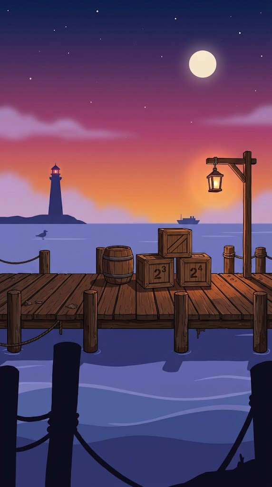
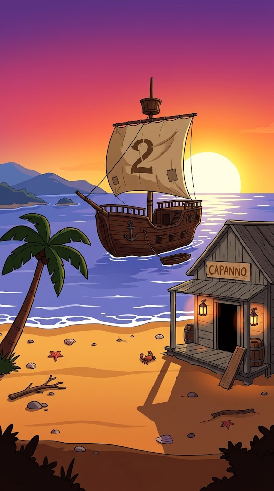
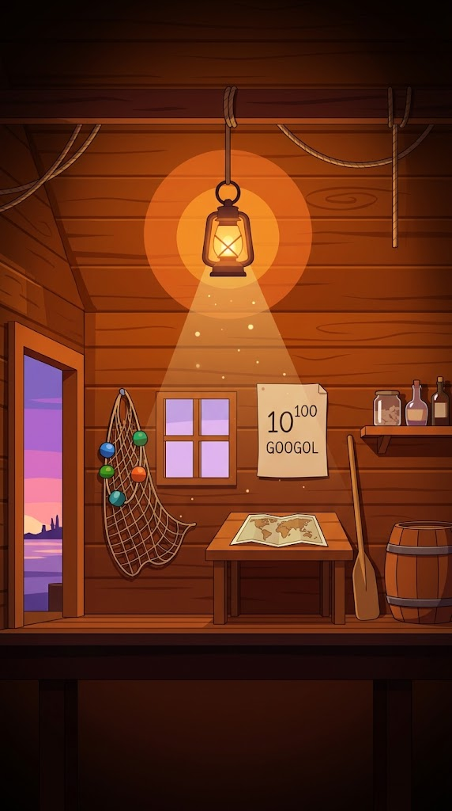
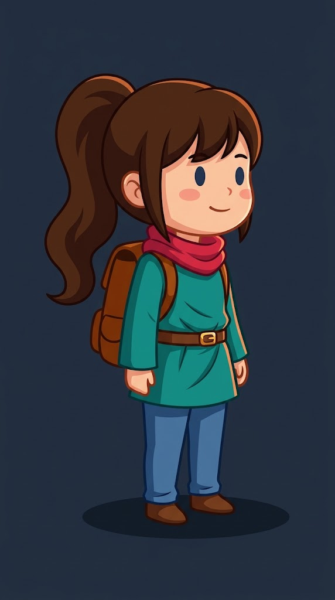
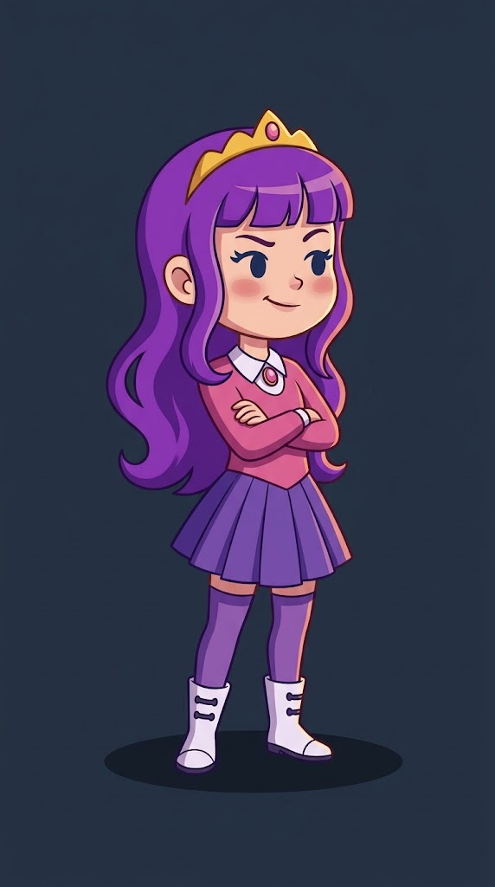
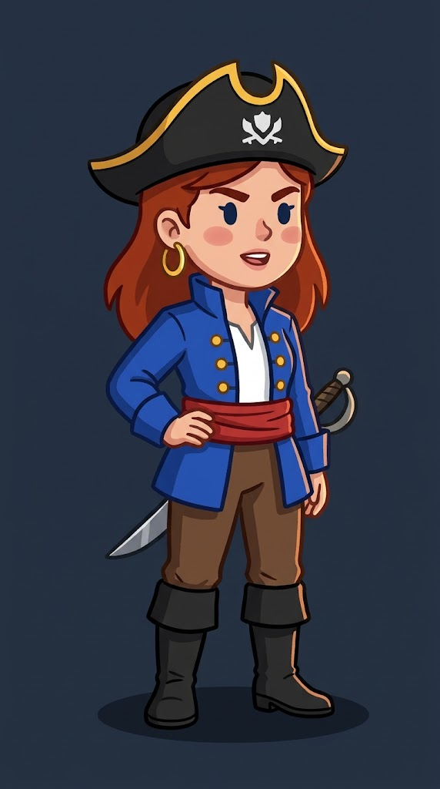
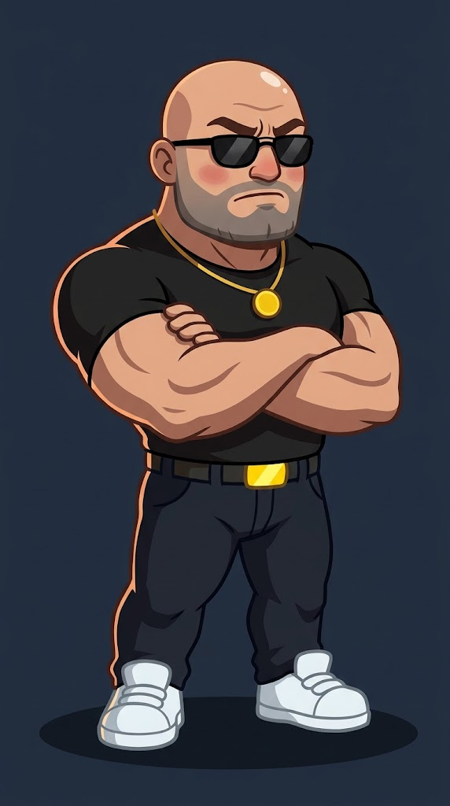
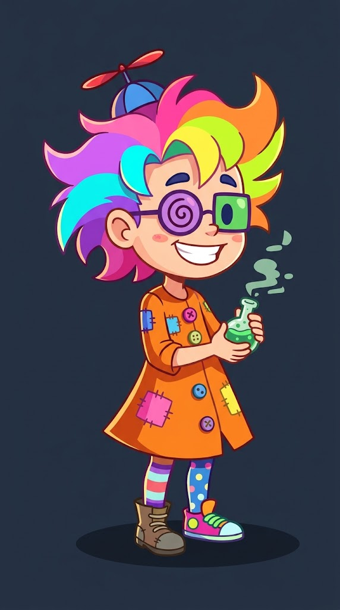

# 🎨 Descrizione grafica

Descrizione dello stile grafico, delle ambientazioni e dei personaggi del gioco.

- **Stile di riferimento:** i mock-up in `docs/mockup/`: area 1 (pontile, spiaggia, capanno) e 5 personaggi (Aria, Lavinia, Capitana Vera, Barnaba, Zia Turbina).
- **Stato:** tutte le 15 stanze, la schermata iniziale e tutti i 13 personaggi usano immagini preparate con Gemini (`img/bg/`, `img/chars/`).
- **Immagini da correggere:** i prompt sono in [`docs/mockup/PROMPT.md`](docs/mockup/PROMPT.md).
- **Dati tecnici:** vengono dal codice (`style.css`, `js/scenes.js`, `js/characters.js`, `js/meta.js`).

| Pontile | Spiaggia | Capanno |
| :---: | :---: | :---: |
|  |  |  |

| Aria | Lavinia | Capitana Vera | Barnaba | Zia Turbina |
| :---: | :---: | :---: | :---: | :---: |
|  |  |  |  |  |

I mock-up delle scene sono verticali (9:16). Nel gioco la scena resta orizzontale (400 × 220): gli stessi elementi sono ricomposti in larghezza.

## 1. Stile generale

### Stile di riferimento (mock-up)

1. Illustrazione da cartone animato per avventura punta-e-clicca, con molti dettagli e un'atmosfera calda.
2. Ombreggiatura a due toni (cel shading): una tinta piena per la luce e una più scura per l'ombra, con bordi netti.
3. Contorno sottile scuro e colorato, mai nero puro: blu notte `#1c1426` sui personaggi, marrone scuro `#2a1a12` sul legno.
4. Materiali disegnati con poche linee:
   - legno: venature e assi separate, chiodi, bordi consumati;
   - tela: pieghe e toppe sulla vela;
   - sabbia: sassolini, conchiglie, legnetti sparsi.
5. Luce forte e calda:
   - sole basso sull'orizzonte o lanterne accese;
   - aloni morbidi arancio intorno alle fonti di luce;
   - ombre lunghe proiettate a terra;
   - bordo chiaro (luce di contorno) sui lati rivolti al sole.
6. Colori saturi e caldi: viola, magenta, arancio e giallo nel cielo; marroni caldi nel legno; blu-viola nel mare.
7. Profondità a strati:
   - in primo piano sagome scure (foglie, rocce, pavimento) che fanno da cornice ai bordi;
   - al centro la scena con gli oggetti cliccabili;
   - sullo sfondo colline e isole blu-viola, più chiare e meno dettagliate.
8. Negli interni gli angoli sono più scuri (vignettatura). La luce cade a cono dalla lanterna o dalla porta, con pulviscolo luminoso.
9. Scritte su cartelli e poster: lettere disegnate a mano, scure su legno o carta chiara.

### Regole tecniche

1. Gli sfondi delle stanze sono immagini WebP in `img/bg/` (1600 × 893, circa 50–100 KB). I personaggi, gli oggetti cliccabili e le animazioni restano in SVG sopra l'immagine.
   - Nello sfondo va solo ciò che non cambia mai. Personaggi, oggetti da prendere, cristalli, cancelli che si aprono e numeri degli enigmi sono in SVG.
   - Sopra l'immagine il codice aggiunge luci che tremolano, stelle, onde e fumo (`IMAGE_SCENES` in `js/scenes.js`).
   - Ogni immagine nuova va aggiunta in `sw.js`, per il gioco offline.
2. Campiture piene e angoli arrotondati. Contorno sottile scuro colorato (0,5–0,9 unità), mai nero puro.
3. Ombre: tinte più scure dello stesso colore o forme scure trasparenti. Nessun gradiente sui personaggi.
4. Gradienti morbidi solo per cieli, pareti, aloni di luce e coni di luce.
5. Vista laterale "a teatrino", senza prospettiva reale.
6. Ogni scena ha almeno 3–4 animazioni continue: stelle, onde, fiamme, oggetti che oscillano.
7. Il gioco rispetta l'impostazione "riduci movimento" del dispositivo.
8. Quasi tutte le scene sono al tramonto o di notte. La Serra è l'unica scena di giorno.

### Colori dell'interfaccia

| Nome | Colore | Uso |
| :--- | :--- | :--- |
| Sfondo scuro | blu notte `#0f172a` | Sfondo dell'app |
| Pannello | ardesia `#1e293b` | Riquadri, dialoghi |
| Bordo | grigio ardesia `#334155` | Bordi dei pannelli |
| Oro | ambra `#f59e0b` | Aura, titoli, pulsanti principali |
| Ciano | `#06b6d4` | Nomi, selezioni, Aria |
| Rosa | `#ec4899` | Accenti, Lavinia |
| Verde | smeraldo `#10b981` | Risposte giuste |
| Testo | bianco `#f8fafc` / grigio `#94a3b8` | Testo principale / secondario |
| Carta | crema `#fffbeb` | Taccuino, pergamene |
| Formule | giallo `#fde047` su blu notte, bordo oro | Riquadro delle formule |

### Caratteri

| Uso | Carattere |
| :--- | :--- |
| Testo | Carattere di sistema (San Francisco, Segoe UI, Roboto) |
| Formule, risposte, calcoli | Courier New (monospazio) |
| Insegne e pergamene | Georgia (con grazie) |
| Opzioni di lettura | OpenDyslexic, Atkinson Hyperlegible |

## 2. Impaginazione dello schermo

Lo schermo è pensato per il telefono in verticale. Dall'alto in basso:

1. **Barra in alto:** Aura, Cristalli, pulsante **Aa** (lettura), pulsante audio.
2. **Scena:** 40% dell'altezza (minimo 220 px). Nel duello scende al 29% (minimo 165 px). Sopra la scena compaiono il nome del luogo, la barra del duello, il fumetto delle azioni e la calcolatrice.
3. **Dialoghi:** ritratto, nome e ruolo di chi parla, riquadro del testo, spiegazioni, pulsanti delle risposte.
4. **Barra in basso:** Taccuino, Mappa, Calcola, Zaino, Profilo.

Le finestre (Taccuino, Mappa, Zaino, Profilo) si aprono sopra tutto, con lo sfondo scuro.

### Formato delle scene

1. Ogni scena misura 400 × 220 unità e riempie il riquadro tagliando i lati (`slice`).
2. Sui telefoni stretti i lati si perdono. Metti gli elementi importanti tra x = 44 e x = 356.
3. Il pavimento è una fascia orizzontale in basso (da y ≈ 157–186). I personaggi camminano sulla linea `groundY` (162–188).
4. Livelli, dal fondo al primo piano: sfondo → oggetti cliccabili → personaggi → primo piano (onde, tavolo, ringhiera) → etichette.

### Schermata iniziale

1. Formato verticale (400 × 800).
2. Cielo al tramonto: dal nero-blu `#050816` all'indaco, al viola, al fucsia, all'ambra `#f59e0b` sull'orizzonte.
3. Luna piena crema in alto a destra, 90 stelle, una stella cadente, nuvole lilla e rosa.
4. Isola scura con due palme e il Faro bianco a fasce rosse che lampeggia.
5. Sopra il Faro fluttuano i 5 cristalli ad arco: ambra, ciano, viola, smeraldo, rosso.
6. Una nave scura attraversa l'orizzonte. In basso a sinistra Aria sta su uno scoglio, grande quasi il doppio.

## 3. Ambientazioni

### Area 1 – Il Molo delle Basi Uguali (nuovo stile)

| Stanza | Luce | Descrizione |
| :--- | :--- | :--- |
| **Pontile** | Sera: cielo blu notte → viola → magenta → arancio, luna piena | Isola a sinistra con il Faro in controluce e la luce rossa che lampeggia. Nave all'orizzonte, nuvole lilla, gabbiano sull'acqua. Pontile di assi con venature, ringhiera di corda sui pali, barile, lampione con lanterna appesa e alone arancio. Pila di casse: una con la croce, due con "2³" e "2⁴" dipinti. Mare blu-viola con riflessi. In primo piano due bitte scure ai bordi. |
| **Spiaggia** | Tramonto, sole grande dietro la nave | Cielo viola → magenta → rosso → arancio → giallo. Colline blu-viola a sinistra. Galeone di Capitana Vera al centro: assi, parapetto, cassero con finestre accese, coffa, ancora, vela beige con toppe e un grande "2". Barca a remi legata. Palma inclinata a sinistra. Capanno di legno grigio con portico, cartello "CAPANNO", due lanterne, botte e asse appoggiata. Sabbia calda con conchiglie, stella marina, sassolini, legnetti e ombre lunghe. Cespugli scuri negli angoli in basso. |
| **Capanno** (interno) | Lanterna centrale con alone e cono di luce, angoli scuri | Pareti di assi orizzontali con venature, trave e corde. Porta aperta sul tramonto e sul mare. Rete con galleggianti colorati, finestrella lilla, poster "10¹⁰⁰ GOOGOL", tavolo con mappa sotto la luce, remo, mensola con barattolo e bottiglie, botte. Pulviscolo che brilla nel cono di luce. |

### Piazza del Mercato (punto centrale sud)

1. Crepuscolo: cielo indaco → viola → arancio.
2. Case colorate (fucsia, petrolio, ocra, viola) con tetti bordeaux, selciato di ciottoli.
3. Festone di bandierine colorate, fontana azzurra con zampilli, due piccioni.
4. Banco di Zia Turbina con tenda a strisce rosse e crema e la scritta "COSE ESPONENZIALI!".
5. Cancello in pietra "TORRE ⬆", con le sbarre finché la strada è chiusa. Sullo sfondo la Torre su una collina viola.

### Area 2 – La Taverna del Quoziente

| Stanza | Luce | Descrizione |
| :--- | :--- | :--- |
| **Strada** | Notte con luna, finestre accese | Facciata in legno con insegna "÷ TAVERNA" che oscilla, porta, lanterna, casse, gatto nero che dorme sul davanzale. |
| **Sala** | Interno caldo a lanterne | Pareti di legno scuro con riflesso arancio. Finestra sul mare di notte, mensola con bottiglie colorate, insegna "TAVERNA DEL ÷ QUOZIENTE ÷". Bancone dell'Oste, grande botte, due lanterne. In primo piano il tavolo tondo dei Pirati Gemelli con dadi che rimbalzano, candela che fuma e monete. |

### Area 3 – La Torre dell'Osservatorio

| Stanza | Luce | Descrizione |
| :--- | :--- | :--- |
| **Terrazza** | Notte stellata, luna crescente | Cielo blu notte → viola con Via Lattea, costellazione, stelle cadenti. Torre in mattoni con cupola e telescopio che si muove. Sfera armillare dorata che gira, libri. A destra l'ascensore a traliccio con ingranaggi, contrappesi "3²" e "2⁴" e luce rossa che lampeggia. |
| **Biblioteca** | Candela, notte dalla finestra | Librerie con dorsi colorati, scala a pioli, finestra ad arco, scrivania. Lavagna verde con l'enigma "(bᵐ)ⁿ = ?" a numeri casuali. |

### Belvedere (punto centrale nord)

1. Crepuscolo: cielo blu notte → viola → pesca, prime stelle, sole basso.
2. Monte viola scuro con il Faro in cima e una scalinata in pietra.
3. Galleria ad arco verso l'Officina con un ingranaggio arancio che gira.
4. Serra lontana a cupola verde chiaro.
5. Mongolfiera rossa a spicchi gialli che fluttua, legata con una fune. Cannocchiale panoramico.

### Area 4 – La Serra degli Esponenti Zero

| Stanza | Luce | Descrizione |
| :--- | :--- | :--- |
| **Giardino** | Giorno pieno, luce verde acqua | Unica scena di giorno. Cupola di vetro e ferro bianco, raggi di luce, pavimento in cotto a scacchi. Liane, foglie di monstera, farfalle rosa e gialla, polline, pozza d’acqua. Cristallo Smeraldo sul piedistallo. Pianta carnivora gigante. |
| **Vivaio (buio)** | Quasi nero | Velo scuro su tutto. Si vede solo il lucernario, che pulsa. |
| **Vivaio (illuminato)** | Cono di luce dal lucernario | Pareti verdi, mattoni, ripiani con germogli e vasi. Compaiono annaffiatoio, poster "BATTERI 2¹⁰" e piantine. |

### Area 5 – L'Officina Steampunk

| Stanza | Luce | Descrizione |
| :--- | :--- | :--- |
| **Officina** | Bagliore arancio della forgia, lampade a gabbia | Muro di mattoni, rame e ottone. Quattro ingranaggi che girano, tubi con vapore, valvola rossa, manometro con lancetta, banco con morsa e scintille, catena con gancio. A destra il cancello verso il Faro, che si apre quando l'area è completata. |
| **Magazzino** | Lampada a sospensione | Mattoni più freddi, scaffale di ricambi, cassettiera. Bilancia in ottone con l'enigma "aⁿ·bⁿ = ?" a numeri casuali. Porta "RICAMBI". |

### Area 6 – La Cima del Faro

| Stanza | Luce | Descrizione |
| :--- | :--- | :--- |
| **Scala** | Tempesta con lampi, torce | Scala a chiocciola in pietra, finestra stretta con lampi, due torce, botola in alto. Graffito "2⁸=256!". |
| **Cima (Faro spento)** | Notte tempestosa | Cielo nero → indaco → viola, nuvole, lampi. Lanterna con cupola rossa e lente, fiammella viola. Piedistallo con 5 alloggiamenti: i cristalli trovati brillano, gli altri sono fori scuri. Ringhiera in primo piano. |
| **Cima (Faro acceso)** | Luce gialla forte | Dopo la vittoria: nucleo giallo che pulsa e due fasci di luce che ruotano. Lampi e scintille spariscono. |

### Mappa dell'isola

1. Isola verde su mare azzurro, bordo di spiaggia, montagna grigia a nord, gruppi di alberi.
2. Sentieri a puntini. Il ponte tra Serra e Officina è tratteggiato.
3. Nodi con icone: azzurro (punti centrali), verde con stelle (completati), arancio (aperti), grigio con 🔒 (chiusi).
4. Rosa dei venti, onde animate, segnaposto 📍 sul luogo attuale.

## 4. Personaggi

### Personaggi a immagine

1. Ogni personaggio è un'immagine WebP in `img/chars/` (640 px di altezza, circa 30–80 KB), preparata su sfondo magenta e ritagliata con `tools/scontorna.py`.
2. Le misure sono in `CHAR_IMG` (`js/characters.js`): occhi, bocca, ritratto, altezza nel gioco.
3. Sopra l'immagine, in SVG: palpebre che sbattono, bocca che parla. Chi ha gli occhiali da sole (Barnaba, Madame Zeri, Zia Turbina) non sbatte le palpebre.
4. Pianta: 2 immagini (fauci chiuse e aperte). Aria: 3 immagini (ferma, passo A, passo B) per la camminata.
5. Per ora il negozio non vende il look di Aria (colori, cappelli, occhiali): chi li aveva comprati riceve indietro l'Aura. Il codice per disegnare cappelli e occhiali sopra la testa resta, per quando arriveranno le immagini degli accessori.

### Oggetti a immagine

1. Gli oggetti sono immagini WebP in `img/obj/` (fino a 256 px, circa 15 KB l'una), preparate con Gemini a fogli 3 × 3 su sfondo magenta e tagliate con `tools/foglio.py` (prompt in `docs/mockup/PROMPT-OGGETTI.md`).
2. Nella stanza ogni oggetto riempie il suo riquadro cliccabile, appoggiato in basso (`obj` nell'oggetto della stanza, `js/objects.js`).
3. Scritte e numeri che cambiano (A-B-C, 2⁵, VIVAIO, 2¹⁰) sono in SVG sopra l'immagine.
4. Le stesse immagini compaiono nello Zaino al posto delle emoji.
5. Gli oggetti cliccabili ondeggiano piano (classe `obj-wobble`): niente puntini gialli. Porte e personaggi non ondeggiano.
6. Emoji: solo quelle presenti su tutti i telefoni (niente 🪙 🪢 🪧 🪟 🪴, che sui telefoni meno recenti non si vedono).

### Regole comuni

1. Tutti guardano a destra e hanno i piedi nel punto (0, 0), con un'ombra ovale a terra.
2. Proporzioni "chibi": testa grande, figura alta 4–5 teste.
3. Occhi: due ovali blu scuro spostati verso destra, con un punto di luce bianco. Guance rosate trasparenti.
4. Nuovo stile (Aria, Lavinia, Vera, Barnaba, Zia Turbina): contorno blu notte `#1c1426`, vista di tre quarti, ombre a due toni, pieghe sui vestiti. Gli altri personaggi saranno allineati.
5. Animazioni comuni:
   - **respiro:** il busto si allunga piano (3,2 s);
   - **occhi:** sbattono ogni 4,6 s;
   - **parla:** la bocca si apre e si chiude;
   - **cammina:** le gambe oscillano, il corpo sobbalza;
   - **colpito:** trema e lampeggia;
   - **sconfitto:** cade in avanti.
6. Il ritratto nei dialoghi è un ritaglio sulla testa del disegno intero. Non è un disegno separato.

### Altezze a confronto

| Personaggio | Altezza |
| :--- | :--- |
| Pianta carnivora | 110 |
| Automa | 84 |
| Barnaba | 82 |
| Terminale | 79 |
| Zia Turbina | 72 |
| Capitana Vera | 67 |
| Archimede | 66 |
| Lavinia | 65 |
| Madame Zeri | 64 |
| Oste Bartolomeo | 61 |
| Aria | 57 |
| Pirati Gemelli, Gemelle Mira e Nora | 56 |

### Aria – la protagonista

1. Ragazza giovane, viso sereno con un piccolo sorriso, guance rosate, orecchio visibile.
2. Capelli castani `#6b3a1c` con frangia di lato e coda di cavallo alta e lunga, mossa, che ondeggia.
3. Tunica verde acqua `#0d9488` lunga fino a metà coscia, maniche lunghe, pieghe in basso.
4. Sciarpa rossa `#e11d48` avvolta al collo, cintura marrone con fibbia dorata.
5. Jeans blu `#4c72c4`, scarpe marroni, zaino marrone con tasca e spallaccio.
6. Si può vestire nel negozio di Zia Turbina:

| Parte | Scelte (prezzo in Aura) |
| :--- | :--- |
| Cappello | Niente, Fiore rosa (60), Cappellino blu (100), Cuffie rosa (120), Cappello pirata (180), Corona d'oro (300) |
| Tunica | Verde mare, Viola (80), Rosa (80), Rosso (80), Notte (120), Oro (200) |
| Sciarpa | Rossa, Azzurra (50), Verde (50), Oro (90) |
| Zaino | Marrone, Rosa (60), Nero (60), Viola (60) |
| Occhiali | Niente, Da sole rosa (120), Da sole oro (160) |

### Capitana Vera – mentore del Molo

1. Più alta di Aria. Capelli rosso rame `#b5481e` lunghi fino alle spalle, orecchino a cerchio d'oro.
2. Sopracciglia decise, sorriso aperto e sicuro.
3. Tricorno nero con bordo d'oro e teschio con ossa incrociate bianco.
4. Giacca blu `#2346c8` lunga con colletto alto e doppia fila di bottoni d'oro, camicia bianca con scollo a V.
5. Fascia rossa `#c62828` in vita con un lembo che pende.
6. Una mano sul fianco. Spada dietro la schiena: elsa a destra, lama a sinistra.
7. Pantaloni marroni, stivali neri alti con risvolto.

### Barnaba il Buttafuori – guardiano del Molo

1. Il più massiccio: spalle larghe, braccia muscolose incrociate, gambe corte e robuste.
2. Testa pelata con riflesso di luce, barba corta grigia `#7f7f88`, orecchie tonde.
3. Occhiali da sole neri, sopracciglia folte aggrottate, bocca dritta: espressione dura.
4. Maglietta nera a maniche corte, catena d'oro con medaglione tondo.
5. Pantaloni neri, cintura scura con fibbia d'oro, scarpe da ginnastica bianche.
6. Non sbatte gli occhi, ma alza le sopracciglia.

### Oste Bartolomeo – mentore della Taverna

1. Tondo e panciuto, gambe corte, testa grande e calva con un ciuffo grigio.
2. Baffoni marroni arricciati, guance rosse: espressione bonaria.
3. Camicia grigia, gilet bordeaux, grembiule bianco, strofinaccio a righe rosse sulla spalla.
4. Tiene un boccale ambra con la schiuma.

### Pirati Gemelli – guardiani della Taverna

1. Due pirati piccoli uguali, uno accanto all'altro.
2. Bandana con pallini bianchi, orecchino d'oro, benda nera su occhi opposti, barba incolta, ghigno.
3. Camicia bianca, gilet aperto: blu `#1d4ed8` per uno, rosso cremisi `#be123c` per l'altro. Fascia gialla, stivali neri.
4. Ognuno tiene in mano un dado bianco.

### Archimede – mentore della Torre (bibliotecario)

1. Tunica lunga blu notte `#1e3a8a` con stelline gialle, orlo d'oro, cordone in vita.
2. Lunga barba bianca a punta, occhialini tondi, sopracciglia bianche spesse.
3. Berretto blu a cupola con nappina d'oro.
4. Alza una lente d'ingrandimento.

### Terminale dell'ascensore – guardiano della Torre

1. Macchina rettangolare grigio ardesia con viti e antenna con luce rossa che lampeggia.
2. Viso sullo schermo verde scuro: occhi e bocca verde fosforo `#4ade80`, righe da vecchio monitor.
3. Tastierino grigio con un tasto verde, pulsante giallo, cavo.

### Madame Zeri – mentore della Serra

1. Caschetto nero voluminoso con frangia, orecchino d'oro.
2. Occhiali da sole con montatura rosa, neo, rossetto cremisi: aria da diva.
3. Abito rosa `#ec4899` a campana, colletto bianco, cintura d'oro, collana di perle, scarpe con tacco.
4. Tiene un ventaglio di piume rosa chiaro.

### Pianta carnivora gigante – guardiana della Serra

1. La più alta: quasi il doppio di Aria.
2. Vaso di terracotta, stelo verde curvo, due foglie, un viticcio.
3. Fauci magenta `#be185d` con macchie rosa, denti crema, lingua rosa.
4. Grandi occhi gialli con pupille a fessura, sopracciglia arrabbiate.
5. Dondola e morde l'aria. Quando perde si rimpicciolisce.

### Gemelle Mira e Nora – mentori dell'Officina

1. Due ragazze piccole con occhialoni da aviatore sulla fronte (lenti ciano) e lentiggini.
2. **Mira:** caschetto nero, salopette azzurra `#0284c7`, chiave inglese.
3. **Nora:** capelli arancio con due chignon, salopette viola `#7c3aed`, cacciavite giallo.
4. Maglia bianca, bottoni d'oro.

### Automa del cancello – guardiano dell'Officina

1. Robot a caldaia color rame `#b45309` con rivetti, visto di fronte.
2. Testa grigio-blu con bulloni, occhi rossi tondi, bocca a griglia.
3. Ciminiera che sbuffa vapore, sportello con fuoco arancio che tremola, manometro con ago che oscilla.
4. Braccia ad arco con pinze, gambe tozze.

### Lavinia – la rivale

1. Capelli viola `#8b3fd1` lunghi e mossi fino alla vita, frangia dritta, tiara d'oro con gemma rosa.
2. Occhi socchiusi con ciglia, sopracciglia arcuate, sorrisetto: aria altezzosa.
3. Maglia rosa `#e05a98` a maniche lunghe con colletto bianco arrotondato e spilla rosa.
4. Braccia incrociate.
5. Gonna viola a pieghe, calze viola lunghe, stivaletti bianchi con bottoni.

### Zia Turbina – la mercante svalvolata

1. Capelli arcobaleno a punte spettinate (rosa, viola, ciano, giallo, lime, arancio) che rimbalzano.
2. Cappellino blu all'indietro con un'elica rossa che gira.
3. Occhiali spaiati: lente tonda viola con una spirale che gira, lente quadrata verde.
4. Sorriso enorme con i denti.
5. Cappotto-vestito arancio con toppe cucite (rosa, gialla, azzurra) e bottoni spaiati con le crocette.
6. Calza a righe e calza a pois, uno stivale marrone e una scarpa da ginnastica rosa.
7. Tiene con due mani un'ampolla verde che fuma.

## 5. Regole per disegnare elementi nuovi

1. Segui lo stile dei mock-up in `docs/mockup/`.
2. Usa campiture piatte e angoli arrotondati. Metti un contorno sottile scuro colorato, mai nero puro.
3. Fai le ombre a due toni con una tinta più scura dello stesso colore. Segna i bordi con la stessa tinta scura.
4. Aggiungi pochi dettagli di materiale: venature, assi, pieghe, sassolini.
5. Metti una fonte di luce calda con alone e ombre lunghe.
6. Incornicia la scena con sagome scure in primo piano negli angoli. Non coprire gli oggetti cliccabili.
7. Prendi i colori dalla scala già usata (palette Tailwind): legni `#78350f`/`#92400e`, pietre `#334155`/`#475569`, luci `#fde68a`/`#fbbf24`, rosso `#dc2626`.
8. Disegna i personaggi con i piedi in (0, 0) e lo sguardo a destra. Registrali in `CHARS` con altezza e ritaglio del ritratto. Usa la stessa ombreggiatura a due toni e la luce calda delle scene.
9. Metti gli oggetti cliccabili tra x = 44 e x = 356, sopra la linea del pavimento.
10. Le uscite sui lati della scena hanno la scritta in un angolo: uscita a destra in alto a destra, uscita a sinistra in basso a sinistra. Se ci sono più uscite sullo stesso lato, le scritte si mettono una sotto l'altra.
11. Tieni almeno 6 pixel tra scritte e puntini cliccabili: il test `tests/rooms.spec.js` lo controlla in tutte le stanze.
12. Dai a ogni scena almeno 3 animazioni lente e sfasate.
13. Scrivi le formule sulle insegne in Courier New, con gli esponenti in apice.
14. Una scena del gioco misura 400 × 220. I mock-up verticali si ricompongono in orizzontale. I bordi laterali si tagliano sui telefoni stretti.
